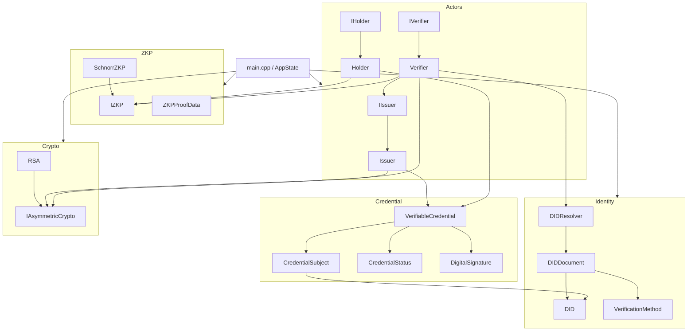
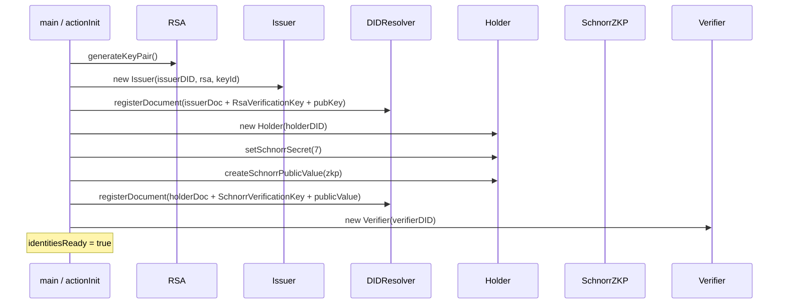
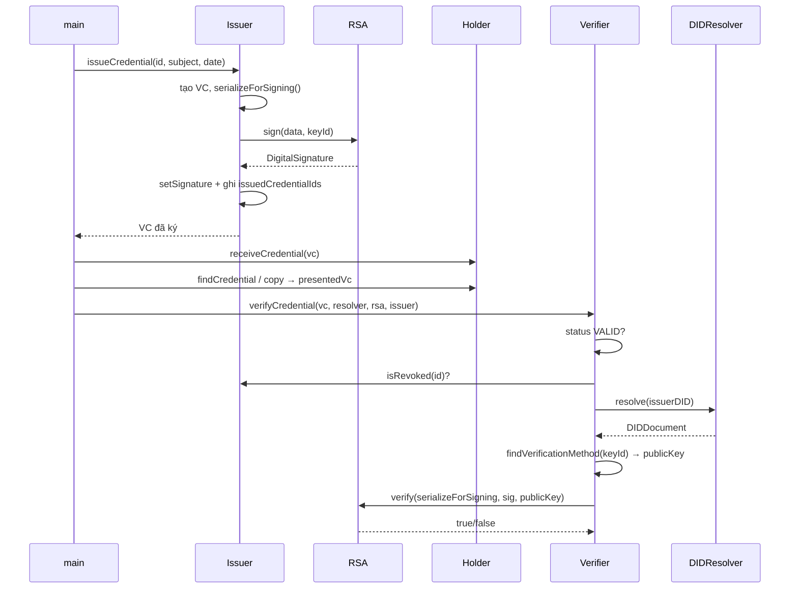
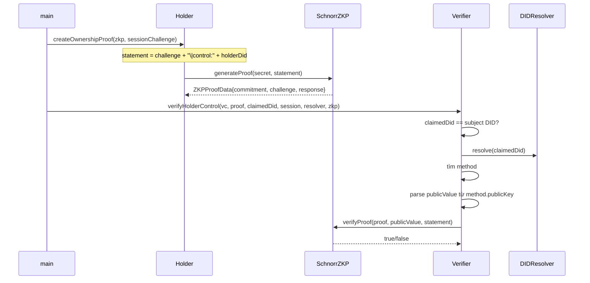
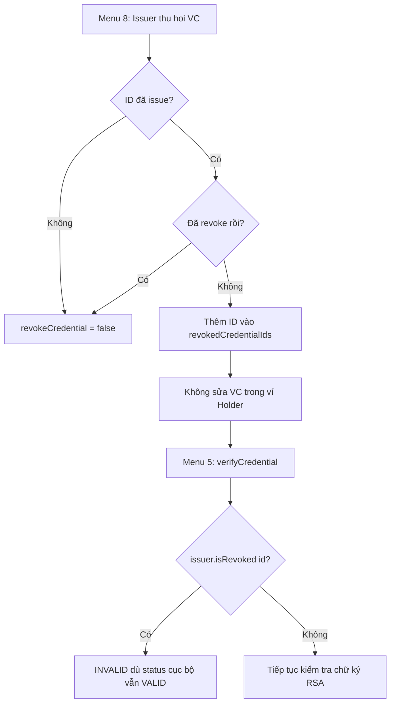

# Tài liệu kỹ thuật chi tiết — Hệ thống DID & Verifiable Credential (Nhóm 5)

> Tài liệu này mô tả **đúng cấu trúc và hành vi của source code hiện tại** trong repository.  
> Đây là mô hình **giáo dục OOP C++**, không phải hệ thống DID/VC production hay chuẩn W3C đầy đủ.

---

## Mục lục

1. [Tổng quan hệ thống](#1-tổng-quan-hệ-thống)
2. [Cây thư mục và vai trò từng file](#2-cây-thư-mục-và-vai-trò-từng-file)
3. [Sơ đồ kiến trúc và luồng nghiệp vụ](#3-sơ-đồ-kiến-trúc-và-luồng-nghiệp-vụ)
4. [Module Identity](#4-module-identity)
5. [Module Credential](#5-module-credential)
6. [Module Crypto](#6-module-crypto)
7. [Module ZKP](#7-module-zkp)
8. [Module Actors](#8-module-actors)
9. [Ứng dụng console — `main.cpp`](#9-ứng-dụng-console--maincpp)
10. [Hệ thống build — `CMakeLists.txt`](#10-hệ-thống-build--cmakeliststxt)
11. [Bộ kiểm thử — `tests/`](#11-bộ-kiểm-thử--tests)
12. [Ánh xạ OOP](#12-ánh-xạ-oop)
13. [Giới hạn và lưu ý trình bày](#13-giới-hạn-và-lưu-ý-trình-bày)

---

## 1. Tổng quan hệ thống

### 1.1. Mục tiêu

Mô phỏng ba vai trò trong hệ sinh thái DID/VC:

| Vai trò | Class | Việc chính trong project |
|---|---|---|
| **Issuer** | `Issuer` | Phát hành VC, ký RSA, quản lý danh sách ID đã cấp / đã thu hồi |
| **Holder** | `Holder` | Lưu VC trong ví, xuất trình VC, tạo Schnorr proof kiểm soát DID |
| **Verifier** | `Verifier` | Xác minh chữ ký RSA + danh sách thu hồi Issuer; xác minh ZKP DID-control |

### 1.2. Hai đường xác minh tách biệt

1. **Đường RSA (toàn vẹn VC):** Issuer ký `serializeForSigning()` → Verifier lấy public key từ `DIDDocument` của Issuer qua `DIDResolver` → `RSA::verify`.
2. **Đường Schnorr (kiểm soát DID Holder):** Holder chứng minh biết secret tương ứng public value đã đăng ký trên DIDDocument Holder → Verifier gọi `SchnorrZKP::verifyProof` (không cần secret).

### 1.3. Quyết định kiến trúc đã chốt (phản ánh trong code)

- Có 5 interface: `IIssuer`, `IHolder`, `IVerifier`, `IAsymmetricCrypto`, `IZKP`.
- **Không** có `ICredential`; `VerifiableCredential` là class cụ thể.
- **Không** có `Actor` base class.
- **Không** có class `Student` / `University` / `Employer`.
- Thu hồi VC do **Issuer** quản lý (danh sách ID trong bộ nhớ), **không** dựa vào sửa `CredentialStatus` trên bản copy trong ví Holder.
- RSA và Schnorr là thuật toán **giáo dục** (tham số nhỏ).

---

## 2. Cây thư mục và vai trò từng file

```text
OOP_DID_Nhom5/
├── main.cpp                 # Menu console 0–9, ghép toàn bộ module
├── CMakeLists.txt           # Target app + 6 target test
├── README.md                # Hướng dẫn ngắn build/run
├── DOCUMENTATION.md         # Tài liệu này
├── .gitignore               # Bỏ qua build/, artifact CMake, *.o, output/, ...
│
├── include/                 # Header công khai (đường include: "module/File.h")
│   ├── identity/
│   │   ├── DID.h
│   │   ├── VerificationMethod.h
│   │   ├── DIDDocument.h
│   │   └── DIDResolver.h
│   ├── credential/
│   │   ├── CredentialSubject.h
│   │   ├── CredentialStatus.h
│   │   └── VerifiableCredential.h
│   ├── crypto/
│   │   ├── IAsymmetricCrypto.h
│   │   ├── RSA.h
│   │   └── DigitalSignature.h
│   ├── zkp/
│   │   ├── IZKP.h           # ZKPProofData + IZKP
│   │   └── SchnorrZKP.h
│   └── actors/
│       ├── IIssuer.h
│       ├── IHolder.h
│       ├── IVerifier.h
│       ├── Issuer.h
│       ├── Holder.h
│       └── Verifier.h
│
├── src/                     # Implementation (.cpp) tương ứng header
│   ├── identity/   (4 file)
│   ├── credential/ (3 file)
│   ├── crypto/     (RSA.cpp, DigitalSignature.cpp)
│   ├── zkp/        (SchnorrZKP.cpp)
│   └── actors/     (Issuer.cpp, Holder.cpp, Verifier.cpp)
│
└── tests/
    ├── test_identity.cpp
    ├── test_credential.cpp
    ├── test_crypto.cpp
    ├── test_actors.cpp
    ├── test_zkp.cpp
    └── test_integration.cpp
```

### 2.1. File cấu hình / tài liệu gốc

| File | Vai trò |
|---|---|
| `main.cpp` | Điểm vào ứng dụng; `AppState` + menu + các `action*` |
| `CMakeLists.txt` | Khai báo nhóm nguồn `IDENTITY_SRC`, `CREDENTIAL_SRC`, …; tạo executable |
| `README.md` | Build, menu, giới hạn giáo dục (ngắn) |
| `.gitignore` | Không commit `build/`, `build_audit/`, `output/`, object/exe, CMake cache |

### 2.2. Quy ước đặt tên / include

- Header dùng `#pragma once`.
- Include path tương đối thư mục `include/`, ví dụ `#include "identity/DID.h"`.
- Interface chỉ có pure virtual + destructor mặc định trong header → **không** có `.cpp` riêng cho interface.
- Class cụ thể: khai báo `.h`, định nghĩa `.cpp`.

---

## 3. Sơ đồ kiến trúc và luồng nghiệp vụ

### 3.1. Sơ đồ phụ thuộc module (logic)



### 3.2. Luồng khởi tạo danh tính (menu 1)



### 3.3. Luồng cấp VC → lưu ví → xác minh RSA (menu 2 → 4 → 5)



### 3.4. Luồng ZKP kiểm soát DID (menu 6 → 7)



### 3.5. Luồng thu hồi Issuer (menu 8 → 5)



### 3.6. Luồng tổng hợp demo đầy đủ (menu 9)

```text
1 Init → 2 Issue → 3 Wallet → 4 Present → 5 Verify(VALID)
  → 6 Create ZKP → 7 Verify ZKP(VALID)
  → 8 Issuer Revoke → 5 Verify lại(INVALID)
```

---

## 4. Module Identity

Thư mục: `include/identity/` + `src/identity/`.

### 4.1. `DID` — `DID.h` / `DID.cpp`

**Vai trò:** Bọc một chuỗi định danh dạng DID.

#### Thuộc tính (`private`)

| Thành phần | Kiểu | Ý nghĩa |
|---|---|---|
| `value` | `std::string` | Chuỗi DID, ví dụ `did:example:issuer001` |

#### Hàm / khai báo (`public`)

| Thành phần | Chữ ký | Mô tả chi tiết |
|---|---|---|
| Constructor mặc định | `DID()` | Gán `value = ""` |
| Constructor tham số | `DID(const std::string& value)` | Lưu chuỗi đầu vào |
| `getValue` | `std::string getValue() const` | Trả chuỗi DID |
| `isValid` | `bool isValid() const` | Kiểm tra quy tắc **của project**: bắt đầu bằng `"did:"`, có dấu `:` thứ hai sau method, phần id không rỗng. **Không** implement toàn bộ chuẩn DID W3C |
| `toString` | `std::string toString() const` | Trả `value` (dùng khi serialize) |
| `operator==` | `bool operator==(const DID& other) const` | So sánh hai chuỗi `value` |

#### Thuật toán `isValid()` (chi tiết)

1. `value` phải bắt đầu bằng `"did:"` (`rfind("did:", 0) == 0`).
2. Tìm dấu `:` thứ hai từ vị trí 4.
3. Nếu không có, hoặc dấu `:` ngay sau `"did"`, hoặc không còn ký tự sau dấu `:` → `false`.
4. Ngược lại → `true`.

Ví dụ hợp lệ: `did:example:holder001`.  
Ví dụ không hợp lệ: `issuer001`, `did:`, `did:example:`.

---

### 4.2. `VerificationMethod` — `VerificationMethod.h` / `.cpp`

**Vai trò:** Một phương thức xác minh gắn với DID (chứa public key công khai).

#### Thuộc tính (`private`)

| Thành phần | Kiểu | Ý nghĩa trong project |
|---|---|---|
| `id` | `std::string` | Key id, ví dụ `did:example:issuer001#key-1` hoặc `...#schnorr-1` |
| `type` | `std::string` | Loại khóa: `"RsaVerificationKey"` hoặc `"SchnorrVerificationKey"` |
| `controller` | `std::string` | DID điều khiển method (thường trùng chủ sở hữu) |
| `publicKey` | `std::string` | Với RSA: chuỗi `n\|e`; với Schnorr: số public value dạng text |

#### Hàm

| Hàm | Mô tả |
|---|---|
| Constructor 4 tham số | Gán lần lượt 4 field |
| `getId` / `getType` / `getController` / `getPublicKey` | Getter trả bản sao chuỗi đã lưu |

**Lưu ý:** Class **không** chứa private key. Private key RSA chỉ nằm trong `RSA`.

---

### 4.3. `DIDDocument` — `DIDDocument.h` / `.cpp`

**Vai trò:** Tài liệu mô tả một DID + danh sách verification method (composition).

#### Thuộc tính (`private`)

| Thành phần | Kiểu | Ý nghĩa |
|---|---|---|
| `did` | `DID` | Chủ thể của document |
| `verificationMethods` | `std::vector<VerificationMethod>` | Danh sách method |

#### Hàm

| Hàm | Hành vi chi tiết |
|---|---|
| `DIDDocument(const DID&)` | Khởi tạo document với DID, danh sách method rỗng |
| `getDID()` | Tham chiếu const tới `did` |
| `addVerificationMethod` | **Bỏ qua** nếu bất kỳ field nào rỗng; **bỏ qua** nếu `id` đã tồn tại; ngược lại `push_back` |
| `getVerificationMethods()` | Tham chiếu const tới vector |
| `findVerificationMethod(methodId)` | Duyệt tuyến tính; tìm thấy → `&vm`; không → `nullptr` |
| `serialize()` | Tạo chuỗi JSON-like (không phải JSON parser): chứa `id` + mảng `verificationMethod` với các field `id`, `type`, `controller`, `publicKeyPem`. **Không** ghi private key |

---

### 4.4. `DIDResolver` — `DIDResolver.h` / `.cpp`

**Vai trò:** “Sổ đăng ký” DIDDocument trong bộ nhớ tiến trình (không phải mạng/blockchain).

#### Thuộc tính (`private`)

| Thành phần | Kiểu | Ý nghĩa |
|---|---|---|
| `documents` | `std::vector<DIDDocument>` | Kho document đã đăng ký |

#### Hàm

| Hàm | Hành vi |
|---|---|
| `registerDocument` | Nếu đã có cùng DID → **ghi đè**; không → `push_back` |
| `resolve(didValue)` | Trả pointer tới document khớp; không có → `nullptr` |
| `exists(didValue)` | `resolve(...) != nullptr` |

**Vai trò trong verify:** Verifier **không** lấy public key trực tiếp từ object `Issuer`, mà resolve DID Issuer → tìm method theo `signature.keyId` → lấy `publicKey`.

---

## 5. Module Credential

Thư mục: `include/credential/` + `src/credential/`.

### 5.1. `CredentialSubject` — subject + claims

#### Thuộc tính

| Thành phần | Kiểu | Ý nghĩa |
|---|---|---|
| `did` | `DID` | DID của chủ thể (Holder) |
| `claims` | `std::map<std::string,std::string>` | Cặp key→value; map đảm bảo thứ tự key ổn định khi serialize |

#### Hàm

| Hàm | Hành vi |
|---|---|
| Constructor | Lưu DID subject |
| `getDID` | Tham chiếu const |
| `addClaim(key, value)` | Gán / ghi đè `claims[key] = value` |
| `hasClaim(key)` | `find != end` |
| `getClaim(key)` | Có → value; không → `""` |
| `getClaims()` | Tham chiếu const map |
| `serialize()` | Chuỗi nhiều dòng: `Subject DID: ...` rồi từng `Claim [k]: v` |

---

### 5.2. `CredentialStatus` + `enum class CredentialState`

#### Enum

```cpp
enum class CredentialState { VALID, SUSPENDED, REVOKED };
```

| Giá trị | Ý nghĩa cục bộ trên object VC |
|---|---|
| `VALID` | Trạng thái mặc định khi tạo |
| `SUSPENDED` | Tạm ngưng (Verifier từ chối vì `!isValid()`) |
| `REVOKED` | Thu hồi **cục bộ trên object** (khác với danh sách thu hồi của Issuer) |

#### Thuộc tính / hàm `CredentialStatus`

| Thành phần | Mô tả |
|---|---|
| `state` (private) | `CredentialState` hiện tại |
| Constructor | `state = VALID` |
| `getState` | Trả enum |
| `isValid` | `state == VALID` |
| `activate` | → `VALID` |
| `suspend` | → `SUSPENDED` |
| `revoke` | → `REVOKED` |
| `toString` | `"VALID"` / `"SUSPENDED"` / `"REVOKED"` / `"UNKNOWN"` |

**Quan trọng nghiệp vụ:** Menu 8 **không** gọi `CredentialStatus::revoke` trên ví Holder. Thu hồi chính thức nằm ở `Issuer::revokedCredentialIds`. Field status vẫn nằm trong `serializeForSigning()`, nên đổi status sau khi ký sẽ làm chuỗi ký lệch (chữ ký không còn khớp nếu vẫn kiểm crypto).

---

### 5.3. `VerifiableCredential` — class VC cụ thể

**Không kế thừa interface.** Composition: chứa `CredentialSubject`, `CredentialStatus`, `DigitalSignature`.

#### Thuộc tính (`private`)

| Thành phần | Kiểu | Ghi chú |
|---|---|---|
| `context` | `std::string` | Gán cứng URL credentials v1 (chuỗi demo, không parse chuẩn) |
| `id` | `std::string` | ID VC, ví dụ `vc-001` |
| `type` | `std::string` | Mặc định `"VerifiableCredential"` |
| `issuerDID` | `std::string` | DID Issuer dạng chuỗi |
| `issuanceDate` | `std::string` | Ngày cấp (chuỗi) |
| `subject` | `CredentialSubject` | Subject + claims |
| `status` | `CredentialStatus` | Trạng thái cục bộ |
| `signature` | `DigitalSignature` | Rỗng đến khi `setSignature` |

#### Constructor

```text
VerifiableCredential(id, issuerDID, subject, issuanceDate, type = "VerifiableCredential")
```

- Gán các field tương ứng.
- `context = "https://www.w3.org/2018/credentials/v1"`.
- `status` mặc định `VALID` nhờ constructor `CredentialStatus`.
- `signature` mặc định empty.

#### Getter / thao tác chữ ký

| Hàm | Mô tả |
|---|---|
| `getId`, `getIssuerDID`, `getType`, `getIssuanceDate` | Trả chuỗi |
| `getSubject`, `getStatus`, `getSignature` | Tham chiếu const |
| `setSignature` | Gán object chữ ký |
| `hasSignature` | `!signature.empty()` |

#### `serializeForSigning()` — chuỗi dùng để ký / verify

Thứ tự cố định:

```text
Context: <context>
ID: <id>
Type: <type>
Issuer: <issuerDID>
Issuance Date: <issuanceDate>
<subject.serialize()>
Status: <status.toString()>
```

- **Có** status trong payload ký.
- **Không** chứa giá trị chữ ký.
- Cùng dữ liệu → cùng chuỗi (ổn định).

#### Quản lý status trên object

| Hàm | Ủy thác |
|---|---|
| `activate` / `suspend` / `revoke` | Gọi tương ứng trên `status` |

#### `display()`

In toàn bộ field + signature (algorithm, keyId, value) hoặc `"Signature: <EMPTY>"`.

---

## 6. Module Crypto

### 6.1. `DigitalSignature` — object dữ liệu chữ ký

#### Thuộc tính

| Field | Ý nghĩa |
|---|---|
| `algorithm` | Tên thuật toán, RSA dùng `"RSA-Educational"` |
| `keyId` | Id verification method dùng khi ký |
| `value` | Giá trị chữ ký (RSA: số mũ hóa dạng chuỗi) |

#### Hàm

| Hàm | Mô tả |
|---|---|
| Constructor mặc định | Ba field rỗng |
| Constructor 3 tham số | Gán đầy đủ |
| Getter | `getAlgorithm`, `getKeyId`, `getValue` |
| `empty()` | `true` nếu `value` **hoặc** `algorithm` rỗng |

---

### 6.2. `IAsymmetricCrypto` — interface

Pure virtual:

| Method | Vai trò |
|---|---|
| `generateKeyPair()` | Tạo cặp khóa |
| `getPublicKey()` | Public key đã encode |
| `sign(data, keyId)` | Ký → `DigitalSignature` |
| `verify(data, signature, publicKey)` | Xác minh bằng public key truyền vào |
| `getAlgorithmName()` | Tên thuật toán |
| `~IAsymmetricCrypto()` | Virtual destructor mặc định |

**Không** có getter private key trên interface → encapsulation.

---

### 6.3. `RSA` — triển khai giáo dục

#### Thuộc tính (`private`)

| Field | Format |
|---|---|
| `publicKey` | `"n|e"` |
| `privateKey` | `"n|d"` |

#### Hàm public (`override`)

| Hàm | Hành vi tóm tắt |
|---|---|
| `RSA()` | Hai key rỗng |
| `generateKeyPair` | Chọn hai số nguyên tố nhỏ, `n=p*q`, `e` (ưu tiên 65537), `d = e^{-1} mod φ(n)`, encode key |
| `getPublicKey` | Trả `publicKey` |
| `sign` | Hash chuỗi → số mod n; `sig = m^d mod n`; trả `DigitalSignature(RSA-Educational, keyId, to_string(sig))`. Input rỗng / chưa có private key → chữ ký empty |
| `verify` | Parse public key; kiểm algorithm, value số; `m' = sig^e mod n`; so với hash(data). Sai key/data/algorithm/empty → `false` |
| `getAlgorithmName` | `"RSA-Educational"` |

#### Helper trong anonymous namespace (`RSA.cpp`) — không xuất hiện ở header

| Helper | Việc làm |
|---|---|
| `NumericKey` | Struct `{modulus, exponent}` |
| `modNormalize` | Đưa số dư về miền `[0, mod)` |
| `isPrime` / `nextPrime` | Kiểm / tìm số nguyên tố |
| `modPow` | Lũy thừa modulo (bình phương liên tiếp) |
| `modInverse` | Nghịch đảo modulo (extended Euclid); thất bại → `-1` |
| `messageToNumber` | Hash polynomial `h = (h*31 + c) % n`, tránh 0 |
| `encodeKey` / `parseKey` / `parseExactLongLong` | Encode/decode `n|e` |
| `randomInRange` | `rand()` trong khoảng (seed 1 lần bằng `time`) |

**Giới hạn:** modulus nhỏ, hash tự chế, `rand` — chỉ minh họa OOP/RSA cơ bản.

---

## 7. Module ZKP

### 7.1. `ZKPProofData` (struct trong `IZKP.h`)

| Field | Ý nghĩa Schnorr |
|---|---|
| `commitment` | `g^nonce mod P` |
| `challenge` | `H(statement | commitment) mod Q` |
| `response` | `nonce + challenge * secret mod Q` |

### 7.2. `IZKP` — interface

| Method | Vai trò |
|---|---|
| `createPublicValue(secret)` | `Y = g^x mod P` |
| `generateProof(secret, statement)` | Tạo proof gắn statement |
| `verifyProof(proof, publicValue, statement)` | Xác minh không cần secret |

### 7.3. `SchnorrZKP` — tham số demo

Hằng số (file `.cpp`, anonymous namespace):

| Ký hiệu | Giá trị | Ý nghĩa |
|---|---|---|
| `P` | 23 | Modulus nguyên tố |
| `Q` | 11 | Cấp nhóm con (`Q | P-1`) |
| `G` | 2 | Generator |

#### Công thức

- Public: `Y = G^x mod P` với `x = secret mod Q`.
- Proof: chọn nonce `r ∈ [1,Q-1]`; `R = G^r`; `c = hash(statement+"|"+R) % Q`; `s = r + c*x mod Q`.
- Verify: `c` phải khớp hash; kiểm `G^s ≡ R * Y^c (mod P)`.

#### Kiểm tra đầu vào trong `verifyProof`

- `publicValue` ∈ `(0, P)`
- `commitment` ∈ `(0, P)`
- `response` ∈ `[0, Q)`
- Challenge phải bằng `hashToChallenge(statement, commitment)`

**Hệ quả:** Miền challenge nhỏ (`Q=11`) → một số statement khác nhau có thể trùng challenge (test ZKP có vòng lặp tìm statement bị từ chối).

---

## 8. Module Actors

### 8.1. `IIssuer` / `Issuer`

#### Interface `IIssuer`

| Method | Nghĩa vụ |
|---|---|
| `getDID` | DID Issuer |
| `getPublicKey` | Public key từ crypto |
| `issueCredential(id, subject, date)` | Tạo + ký + trả VC |
| `revokeCredential(id)` | Thu hồi theo ID (in-memory) |
| `isRevoked(id)` | Tra cứu danh sách thu hồi |

#### Class `Issuer` — thuộc tính private

| Field | Kiểu | Vai trò |
|---|---|---|
| `did` | `DID` | Định danh Issuer |
| `crypto` | `IAsymmetricCrypto&` | Tham chiếu đa hình (thường là `RSA`) |
| `verificationMethodId` | `std::string` | Key id gắn vào chữ ký |
| `issuedCredentialIds` | `std::set<std::string>` | ID đã cấp |
| `revokedCredentialIds` | `std::set<std::string>` | ID đã thu hồi |

#### `issueCredential` — từng bước

1. Tạo `VerifiableCredential` với `issuerDID = did.toString()`.
2. `data = vc.serializeForSigning()`.
3. `signature = crypto.sign(data, verificationMethodId)`.
4. `vc.setSignature(signature)`.
5. `issuedCredentialIds.insert(id)`; `revokedCredentialIds.erase(id)` (cấp lại ID thì xóa trạng thái revoke cũ).
6. Return VC theo giá trị (copy).

#### `revokeCredential`

- `false` nếu ID không nằm trong `issuedCredentialIds`.
- `false` nếu đã nằm trong `revokedCredentialIds`.
- Ngược lại insert vào revoked → `true`.
- **Không** sửa object VC, **không** đổi status trong payload đã ký.

#### `isRevoked`

- `true` nếu id ∈ `revokedCredentialIds`.

#### `getPublicKey`

- Ủy thác `crypto.getPublicKey()` (dùng khi đăng ký DIDDocument).

---

### 8.2. `IHolder` / `Holder`

#### Interface — ví + ZKP DID-control

| Method | Vai trò |
|---|---|
| `getDID` | DID Holder |
| `receiveCredential` | Đưa VC vào ví (copy) |
| `getCredentials` | Tham chiếu vector ví |
| `findCredential(id)` | Pointer hoặc `nullptr` |
| `setSchnorrSecret` | Lưu secret Schnorr hợp lệ |
| `getSchnorrMethodId` | `did + "#schnorr-1"` |
| `createSchnorrPublicValue` | `zkp.createPublicValue(secret)` hoặc `0` |
| `createOwnershipProof` | Tạo proof với statement control |

**Không còn** `revokeCredential` trên Holder.

#### Thuộc tính `Holder`

| Field | Ý nghĩa |
|---|---|
| `did` | DID Holder |
| `credentials` | Ví VC |
| `schnorrSecret` | Secret; 0 nếu chưa set hợp lệ |
| `hasSchnorrSecret` | Cờ đã có secret hợp lệ |

#### Helper nội bộ (`Holder.cpp`, anonymous namespace)

| Helper | Việc |
|---|---|
| `kSchnorrQ = 11` | Khớp Q của Schnorr demo |
| `isValidSchnorrSecret` | `secret % Q != 0` (sau chuẩn hóa dương) |
| `makeControlStatement` | `sessionChallenge + "|control:" + holderDid` |

#### `createOwnershipProof`

- Nếu thiếu secret hoặc challenge rỗng → `ZKPProofData{}` (0,0,0).
- Ngược lại `zkp.generateProof(secret, makeControlStatement(...))`.
- Secret **không** rời khỏi Holder.

---

### 8.3. `IVerifier` / `Verifier`

#### `verifyCredential(credential, resolver, crypto, issuer)` — checklist tuần tự

1. `credential.getStatus().isValid()` — từ chối SUSPENDED/REVOKED cục bộ.
2. `credential.getIssuerDID() == issuer.getDID().getValue()` — đúng Issuer đang hỏi.
3. `!issuer.isRevoked(credential.getId())` — danh sách thu hồi Issuer.
4. Chữ ký không empty.
5. `resolver.resolve(issuerDID)` ≠ `nullptr`.
6. `findVerificationMethod(signature.getKeyId())` ≠ `nullptr`.
7. Public key không rỗng.
8. `crypto.verify(serializeForSigning(), signature, publicKey)`.

#### `verifyZKProof`

- Chỉ gọi `zkp.verifyProof(...)` — không tự viết lại Schnorr.

#### `verifyHolderControl` — checklist

1. `claimedHolderDid` và `sessionChallenge` không rỗng.
2. `claimedHolderDid == credential.subject.did`.
3. Resolve Holder DIDDocument.
4. Method id = `claimedDid + "#schnorr-1"` tồn tại.
5. `controller == claimedDid`, `type == "SchnorrVerificationKey"`.
6. Parse `publicKey` thành `long long > 0`.
7. Statement = `sessionChallenge + "|control:" + claimedDid`.
8. `zkp.verifyProof(proof, publicValue, statement)`.

Helper nội bộ Verifier: `makeControlStatement`, `makeSchnorrMethodId`, `parsePublicValue`.

---

## 9. Ứng dụng console — `main.cpp`

Toàn bộ logic menu nằm trong anonymous namespace; `main()` chỉ vòng lặp chọn menu.

### 9.1. `struct AppState` — trạng thái phiên

| Field | Kiểu | Vai trò |
|---|---|---|
| `identitiesReady` | `bool` | Đã chạy menu 1 chưa |
| `rsa` | `RSA` | Crypto Issuer |
| `zkp` | `SchnorrZKP` | Engine ZKP |
| `resolver` | `DIDResolver` | Sổ DIDDocument |
| `issuer` / `holder` / `verifier` | `unique_ptr<...>` | Ba actor |
| `nextVcIndex` | `int` | Sinh id `vc-001`, `vc-002`, … |
| `lastIssuedId` | `string` | ID VC vừa cấp |
| `hasPresented` / `presentedVc` | flag + `unique_ptr<VC>` | Bản VC đang xuất trình (copy) |
| `sessionChallenge` / `lastProof` / `hasProof` | ZKP session | Challenge + proof lần tạo gần nhất |

### 9.2. Hàm tiện ích

| Hàm | Việc |
|---|---|
| `printMenu` | In menu 0–9 |
| `requireIdentities` | Bắt buộc đã init |
| `requireWalletVc` | Init + ví không rỗng |
| `requirePresented` | Đã menu 4 |
| `requireProof` | Đã menu 6 |
| `makeVcId(index)` | `vc-` + zero-pad 3 chữ số |

### 9.3. Hành vi từng mục menu

| Mục | Hàm | Hành vi chi tiết |
|---|---|---|
| 1 | `actionInit` | Sinh RSA; tạo Issuer + đăng ký RSA method; tạo Holder + secret 7 + đăng ký Schnorr method; tạo Verifier; khóa không cho init lại |
| 2 | `actionIssue` | Tạo subject (name, membership); `issuer.issueCredential`; `holder.receiveCredential`; cập nhật `lastIssuedId` |
| 3 | `actionWallet` | Liệt kê ID, issuer, subject, status, name |
| 4 | `actionPresent` | Copy VC (`lastIssuedId` hoặc VC cuối) vào `presentedVc`; `display()` |
| 5 | `actionVerifyVc` | `verifier.verifyCredential(presented, resolver, rsa, *issuer)` |
| 6 | `actionCreateZkp` | Sinh `sessionChallenge`; `holder.createOwnershipProof` |
| 7 | `actionVerifyZkp` | `verifier.verifyHolderControl(...)` |
| 8 | `actionRevoke` | `issuer.revokeCredential(id)` — **không** đổi status ví |
| 9 | `actionFullDemo` | Chạy tuần tự 1…8 rồi verify lại sau revoke |
| 0 | — | Thoát vòng `while` |
| Khác | — | `"Lua chon khong hop le"` |

### 9.4. `int main()`

```text
AppState app
in vòng lặp:
  printMenu → đọc choice
  switch/if tới action tương ứng
return 0
```

---

## 10. Hệ thống build — `CMakeLists.txt`

| Thành phần CMake | Nội dung |
|---|---|
| `cmake_minimum_required` | ≥ 3.16 |
| `project` | `VerifiableCredential` |
| `CMAKE_CXX_STANDARD` | 17 |
| Biến nguồn | `IDENTITY_SRC`, `CREDENTIAL_SRC`, `CRYPTO_SRC`, `ACTORS_SRC`, `ZKP_SRC` |
| Target app | `VerifiableCredential` = `main.cpp` + mọi nhóm nguồn |
| Target test | `test_identity`, `test_credential`, `test_crypto`, `test_actors`, `test_zkp`, `test_integration` |
| Include | `target_include_directories(... PRIVATE include)` cho mọi target |

`test_credential` chỉ link `DID.cpp` + credential + `DigitalSignature.cpp` (đủ phụ thuộc).  
`test_zkp` chỉ link `SchnorrZKP.cpp`.

---

## 11. Bộ kiểm thử — `tests/`

Tất cả test dùng `assert` — fail thì abort; in `PASSED` khi xong từng nhóm.

### 11.1. `test_identity.cpp`

| Hàm test | Kiểm tra |
|---|---|
| `testDID` | getValue, isValid true/false, `operator==` |
| `testVerificationMethod` | 4 getter |
| `testDIDDocument` | add, find có/không (`nullptr`) |
| `testDIDResolver` | resolve/exists có và không |
| `testFullIdentityFlow` | resolve → find method → public key |

### 11.2. `test_credential.cpp`

| Hàm | Kiểm tra |
|---|---|
| `testSubjectAndStatus` | claim + chu trình VALID→SUSPENDED→REVOKED→activate |
| `testVerifiableCredential` | getter, `hasSignature` trước/sau, serialize ổn định, signature không nằm trong payload |

### 11.3. `test_crypto.cpp`

| Hàm | Kiểm tra |
|---|---|
| `testDigitalSignature` | empty / not empty |
| `testRSA` | sign/verify OK; data đổi fail; public key sai fail; empty sig / sai algorithm / value không phải số fail |

### 11.4. `test_zkp.cpp`

| Hằng / hàm | Việc |
|---|---|
| `secret`, `holderDid`, `sessionChallenge` | Input demo DID-control |
| `makeStatement` | Cùng format control statement |
| `testValidProof` | Proof đúng → true |
| `testModifiedProof` | Đổi response → false; vòng tìm statement khác bị reject |
| `testWrongPublicValue` | `publicValue = 0` → false |

### 11.5. `test_actors.cpp`

| Hàm | Kiểm tra |
|---|---|
| `testHolder` | receive / find / not found |
| `testIssuer` | issue có chữ ký, keyId đúng |
| `testVerifier` | valid; Issuer revoke (status VC vẫn VALID nhưng verify false); revoke ID lạ/fail; VC khác vẫn valid; suspend; unknown issuer; wrong keyId; modified claims; wrong public key |
| `testVerifierZKP` | verifyZKProof low-level |
| `testHolderDidControl` | ownership proof + các case fail (tamper, missing DID/method, wrong DID/public/session) |

### 11.6. `test_integration.cpp`

| Hàm | Kiểm tra |
|---|---|
| `testValidFullFlow` | RSA verify + Holder control ZKP end-to-end |
| `testInvalidCases` | Issuer revoke; revoke fail; VC khác OK; suspend; unknown issuer; wrong key; modified; wrong resolver key |

---

## 12. Ánh xạ OOP

| Nguyên lý | Biểu hiện trong code |
|---|---|
| **Encapsulation** | Field `private`; truy cập qua getter/method; RSA không lộ `privateKey` |
| **Abstraction** | 5 interface pure virtual quy định hợp đồng |
| **Inheritance** | `Issuer:IIssuer`, `Holder:IHolder`, `Verifier:IVerifier`, `RSA:IAsymmetricCrypto`, `SchnorrZKP:IZKP` + `override` |
| **Polymorphism** | `Issuer` giữ `IAsymmetricCrypto&`; Verifier nhận `IAsymmetricCrypto` / `IZKP` / `IIssuer` theo interface |
| **Composition** | `DIDDocument` chứa DID + methods; `VC` chứa subject/status/signature; `Holder` chứa vector VC; `AppState` ghép toàn hệ |

---

## 13. Giới hạn và lưu ý trình bày

1. **Không** tuyên bố tuân thủ đầy đủ W3C DID/VC; URL context chỉ là chuỗi.
2. **Không** có blockchain, database, API server, Verifiable Presentation class.
3. RSA/Schnorr tham số nhỏ — chỉ giáo dục.
4. `DIDResolver` và danh sách thu hồi Issuer chỉ sống trong **bộ nhớ tiến trình**.
5. Bản VC trong ví Holder sau thu hồi có thể vẫn hiện `status=VALID` cục bộ; Verifier vẫn `INVALID` nhờ `issuer.isRevoked`.
6. Đổi `CredentialStatus` sau khi ký làm lệch `serializeForSigning` so với chữ ký (đường status cục bộ vẫn có thể từ chối sớm qua `isValid()`).

---

## Phụ lục A — Bảng tra nhanh “file → class/struct chính”

| File | Thành phần chính |
|---|---|
| `DID.h/.cpp` | `DID` |
| `VerificationMethod.h/.cpp` | `VerificationMethod` |
| `DIDDocument.h/.cpp` | `DIDDocument` |
| `DIDResolver.h/.cpp` | `DIDResolver` |
| `CredentialSubject.h/.cpp` | `CredentialSubject` |
| `CredentialStatus.h/.cpp` | `CredentialState`, `CredentialStatus` |
| `VerifiableCredential.h/.cpp` | `VerifiableCredential` |
| `DigitalSignature.h/.cpp` | `DigitalSignature` |
| `IAsymmetricCrypto.h` | `IAsymmetricCrypto` |
| `RSA.h/.cpp` | `RSA` (+ helper nội bộ) |
| `IZKP.h` | `ZKPProofData`, `IZKP` |
| `SchnorrZKP.h/.cpp` | `SchnorrZKP` (+ P,Q,G helper) |
| `IIssuer.h` / `Issuer.h/.cpp` | `IIssuer`, `Issuer` |
| `IHolder.h` / `Holder.h/.cpp` | `IHolder`, `Holder` |
| `IVerifier.h` / `Verifier.h/.cpp` | `IVerifier`, `Verifier` |
| `main.cpp` | `AppState`, menu actions, `main` |

---

## Phụ lục B — Chuỗi statement ZKP chuẩn trong project

```text
<sessionChallenge>|control:<holderDid>
```

Ví dụ: `session-vc-002-zkp|control:did:example:holder001`

Holder tạo proof với statement này; Verifier dựng lại **cùng** statement khi verify. Sai challenge/DID → challenge Schnorr lệch hoặc phương trình verify fail.

---

*Hết tài liệu. Cập nhật `DOCUMENTATION.md` khi thay đổi API hoặc nghiệp vụ thu hồi / verify.*
